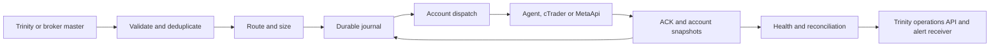

# CopierR 2.0 — System architecture, reliability and execution design

CopierR is a Rust service for paper-trade qualification and follower execution. Trinity owns strategy permission, operator access and alert escalation. CopierR applies follower sizing, tracks broker outcomes and exposes its own loopback operations API.

## Execution and recovery

- The daemon records planned work before dispatch. It reserves a bounded channel slot, records dispatch, then hands the command to the venue. A follower has at most one unresolved dispatched command at a time. A subsequent event for the same trade waits for the binding or previous change. A source close or cancellation supersedes a matching queued placement before it reaches the follower.
- Broker connection setup requires a valid initial snapshot. Direct venues reconnect with bounded backoff. MetaApi polls all connected accounts and cTrader requests periodic reconciliation snapshots. A poll failure, timed-out cTrader response or stale snapshot stops new direct dispatch. Direct master opens wait for their source order to appear in a current snapshot.
- A dispatched command becomes `UNKNOWN` after a restart, disconnect or acknowledgement deadline. CopierR accepts a valid late acknowledgement and does not automatically resend the command. It holds a follower when the broker snapshot shows missing, untracked or differently sized exposure. Existing source positions establish the initial baseline. If an already-mirrored source position changed while disconnected or scaled in place, inspect it before clearing the resulting hold.
- The JSONL journal streams records during startup and periodically replaces its history with an atomic checkpoint. An exclusive file lock prevents two CopierR processes from using the same journal. `fsync` is the deployment setting. A malformed or incomplete journal stops startup so the last known execution state can be checked. Timestamp-based deduplication expiry is optional. Producers that enable it must retry with the original event ID and timestamp. Legacy deduplication keys are retained.
- Follower caps use the broker snapshot to count existing positions and pending commitments and to sum gross lots. Each route still controls symbol mapping, sizing and volume step. cTrader checks units against symbol metadata, and MetaApi checks the mapped symbol's minimum, maximum and step before sending opens or reductions. A cap or invalid quantity rejects a new exposure instead of resizing it. Gross lots are an account-level volume ceiling across symbols.
- A sized open below the route's `min_volume` is refused, never raised to the minimum (a 0.1x copy of 0.05 lots is not opened at 0.01). Above `max_volume` it is capped at the route's maximum.
- Route settings govern new exposure only. `enabled = false`, `allow_symbols`, `deny_symbols` and the buy/sell filters stop opens and pending placements; modify, reduce, close, amend and cancel always follow a copy the route already made, so switching a route off never strands its copies. Only the route that made a copy changes it. A route that still has copies cannot be removed from the configuration: startup stops with the route's name. Set `enabled = false`, let its copies close or reconcile them, then remove it.
- A reversed route copies the source's stop loss as the follower's take profit and the source's take profit as its stop loss, so both stay on the correct side of the reversed trade.
- When the durable backlog is full, the follower is held and a new open is dropped. A change to an existing copy (reduce, close, modify, amend, cancel) is kept in the deferred list and sent once the hold clears, so a close is never lost.
- cTrader market opens fill first and receive their stop loss and take profit in a second request. If that request fails, the open is still acknowledged as filled with its position ID, so the copy stays bound and the source's later changes and close reach it. The copy is recorded as unprotected (`ProtectionState` journal record, `unprotected` in `/v1/status`, alert `protection_missing`) until a stop update for it succeeds or it closes. Set the protection at the broker or wait for the source's next stop change.

## Pending orders

Enable `pending_routes` for the selected route IDs. An upstream agent can publish `place_limit`, `place_stop`, `amend_pending` and `cancel_pending`. The cTrader and MetaApi adapters can place, amend and cancel GTC follower orders. The source must report a positive absolute trigger price in the existing `price` field for placement and amendment. Use this only where the source and mapped symbol share a compatible price scale. Reverse pending routes are rejected during configuration validation.

Pending order IDs have their own ledger bindings and reconciliation checks. The service holds the follower when a pending binding disappears unexpectedly or changes size without a matching acknowledgement. Independent fills, stop-limit orders, GTD expiry, pending-volume changes and native direct-master pending discovery are the current feature boundaries. For a fill reviewed by an operator, confirm the broker outcome, remove the missing pending binding, and adopt the position using its own source and follower IDs. Keep the source from separately publishing a market open for the same pending fill until the position mapping is established.

## Trinity operations contract

Configure `ops_listen = "127.0.0.1:48101"` and `ops_token_env = "COPIERR_OPS_TOKEN"`. All operations require an HTTP `Authorization: Bearer <token>` header and write requests use JSON.

| Method and path | Request and result |
| --- | --- |
| `GET /v1/status` | Account readiness and exposure, queued commands, unresolved outcomes and reasons, recent failures and reviews, active alerts, and queue-to-dispatch and dispatch-to-acknowledgement histograms |
| `PUT /v1/pause` | `{"paused":true}` or `{"paused":false}`. Persist the desired state. Already dispatched commands can still complete |
| `PUT /v1/hold` | `{"account_id":"follower","reason":"inspect broker history"}`. Use `null` after reconciliation to clear the account hold |
| `PUT /v1/resolve` | `command_id`, `account_id`, terminal `status` of `filled` or `rejected`, `reason`, and `external_id` when confirming a placement. Pause first and verify the broker outcome. A queued command may be rejected before dispatch |
| `PUT /v1/reconcile` | `route_id`, `source_id`, optional `pending`, and `reason`. Supply `target_id` and verified current `source_lots` to adopt/rebase a binding, or use a null `target_id` to remove an absent binding. Requires pause and fresh follower state |

Alert kinds: `account_disconnected`, `reconciliation_required`, `snapshot_unavailable`, `dispatch_held`, `execution_unknown`, `execution_rejected` and `protection_missing`.

Trinity can poll alerts or configure `alerts_url_env` for an HTTPS receiver and `alerts_token_env` for an optional bearer token. The daemon sends the current alert set on change and retries delivery with backoff. A clearing update sends an empty set when all alerts clear. The receiver can deduplicate by alert kind, account and command ID. Alert snapshots include disconnected accounts, unavailable supporting snapshots, reconciliation discrepancies, held accounts and recent failed executions.

## Build and install

GitHub Actions tests on Debian 13 x86-64 using Rust 1.81 and packages the release executable, systemd unit and sample configuration with a SHA-256 checksum. Matching version tags create draft releases for review. A Linux host needs the packaged binary and compatible system libraries.

1. Verify the release archive with `sha256sum -c copierr-vVERSION-debian13-x86_64.tar.gz.sha256` and extract it.
2. Install the extracted directory as `/opt/copierr/releases/vVERSION` and link `/opt/copierr/current` to the selected version.
3. Put configuration without secrets in `/etc/copierr/copierr.toml`, readable by the service user. Put credentials in root-owned mode-0600 `/etc/copierr/copierr.env`, agent tokens included (`token_env` on each agent account). The agent port speaks plain TCP, so `listen` must be a loopback address: reach remote agents through an SSH or Tailscale tunnel, or bind the tunnel's address and set `allow_remote_agents = true`. Set the journal path to `/var/lib/copierr/copier.journal.jsonl` and use `durability = "fsync"`.
4. Install `copierr.service` in `/etc/systemd/system`. Before upgrading a running instance, pause dispatch and check for outstanding broker work. Restart, verify account status and reconcile before resuming.
5. Retain the previous binary and a stopped-service backup of the journal before migration. The prior 0.2 binary cannot read the 2.0 journal record vocabulary. A downgrade needs reconciliation of any executions recorded after the backup before the earlier service can resume.

## Qualification

Use master and follower demo accounts to verify position IDs, pending IDs, partial fills, protection updates, lot conversion and netting/hedging behavior for each broker and account mode. Run burst and disconnect scenarios before collecting latency. `queue_to_dispatch` includes persistence and dispatch scheduling. `dispatch_to_ack` includes transport, broker and client overhead. Histogram buckets count each observation once, with the final bucket above the largest bound. Record idle RSS and CPU, per-account increments, journal storage and replay time, queue depth, rejected work, and 24-hour and 7-day memory trends. Repository tests and local simulations cover the journal and failure paths. Broker demo and long-running measurements require a separate qualification run.

Run `cargo test --locked --workspace` for the Rust suite. After building the release, run `python3 tests/smoke_brokers.py target/release/copierr` to exercise both broker adapters and the operations API with loopback simulators.

See the [reference inventory](references.md) for the repository revisions and licensing.
